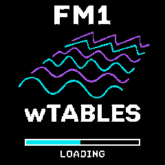

# FM1 wTABLES — RC1

**Release candidate 0.83.0-rc1**, built from the supplied TEST83 source with the approved layered-waveform splash and a six-second startup display. The splash itself contains **FM1**, **wTABLES**, and **LOADING**, with no RC label. Release metadata and downloadable filenames identify this build as RC1.

wTABLES is a polyphonic wavetable synthesizer for the FM-1, with eight startup voices, a shared dynamic voice pool, dual-core rendering, Bloom sequencing, modulation, per-voice filters and envelopes, chorus, delay, and reverb.

## Downloads

| File | Purpose |
| --- | --- |
| [FM1-wTABLES-RC1.fwsc](firmware/FM1-wTABLES-RC1.fwsc) | Application update through the existing FM1 firmware updater. Requires the matching wavetable data already installed. |
| [FM1-wTABLES-RC1-M-Flasher.bin](firmware/FM1-wTABLES-RC1-M-Flasher.bin) | Full 1 MiB M-Flasher image, including the matching external wavetable partition. |
| [SHA256SUMS.txt](firmware/SHA256SUMS.txt) | Checksums for the current and retained historical firmware files. |
| [Editable source and build scripts](source/) | Browseable source used for this RC build. |
| [Repository ZIP](https://github.com/Kayman18/FM1-wTABLES/archive/refs/heads/main.zip) | Download the complete repository snapshot. |

Use each file with its matching update method; a full M-Flasher `.bin` is a different format from `.fwsc`. The M-Flasher packer validates the compiled application and banks and preserves the protected regions from its supplied compatible base image.

## Actual firmware screens

These are **240 × 240 framebuffer captures from the RC1 host simulator**, using the same drawing code and assets compiled into the firmware. The splash is captured at its three-second midpoint. They are not photographs of a physical FM-1; battery readings are simulated.

| Six-second loading splash | Main WAVE page |
| --- | --- |
|  |  |

| Filter | Amp envelope | LFO matrix |
| --- | --- | --- |
|  |  |  |

| Bloom sequencer | Preset browser | Reverb |
| --- | --- | --- |
|  |  |  |

[Capture reproduction instructions](docs/GUI-CAPTURES.md) · [Capture script](source/tests/readme-screens.txt)

## RC1 changes

- Approved splash option 2: cyan and purple layered waveforms on black, with white FM1/wTABLES lettering. The RC1 text was removed from the artwork as requested.
- A progress bar advances over **6000 ms from completion of the first splash display**. The normal service loop continues during loading; the watchdog, USB/update handling, audio service, and wavetable preparation are not blocked by a six-second sleep.
- Startup notes and control gestures are consumed while loading, and audio stays silent. Piano keys held through startup must be released before they sound. Recovery/update screens have priority, and returning from an updater session does not replay the splash.
- The image reuses the existing canvas and is encoded as a compact four-colour RLE asset. The approved original, generated asset, and regeneration script are included in the source.
- TEST83's eight-voice default and CPU optimizations are retained, including the four-plus-four dual-core allocation, cached calculations, inlined hot leaves, and executable-SRAM voice loop.
- The target image builder now includes the `.voice_hot` executable-SRAM section at its linker-assigned flash load address. A build check verifies the bytes that startup copies to SRAM against the linked ELF.
- Firmware identity and USB/display metadata are updated for **0.83.0-rc1 / FM-1_13008300**.

The existing CC74 cutoff, CC71 resonance, CC64 sustain, and pitch-bend behavior is retained. Eight remains the maximum physical voice count; RC1 does not raise that cap.

## Build and validation

See [BUILD-VALIDATION.md](BUILD-VALIDATION.md) for the actual RC1 build, startup, image-integrity, and regression results. Host tests establish correctness and audio equivalence for the checked cases; physical FM-1 boot timing, listening, and worst-case CPU/deadline headroom still require hardware testing.

The source includes matched fonts and the SDK support subset. A compatible JieLi PI32v2 compiler is a separate dependency. This release uses `jieli-linux-toolchains-20260730.1`.

```sh
cd source
export JIELI_TOOLCHAIN=/absolute/path/to/jieli-linux-toolchains-20260730.1
bash build-RC1-linux.sh
```

To also create a full image from a known-compatible 1 MiB backup:

```sh
bash build-RC1-linux.sh /absolute/path/to/compatible-backup.bin FM1-wTABLES-RC1-M-Flasher.bin
```

The wrapper builds `fm1/app/build/pwcore.bin` and `fm1/app/build/pwcore-0.83.0-rc1.fwsc`. The published updater is a byte-for-byte copy renamed `FM1-wTABLES-RC1.fwsc`.

Engine regression:

```sh
cd source
bash tests/run82.sh
sh tests/run_rc1_splash.sh
```

See [source/README-RC1.md](source/README-RC1.md) for dependencies and packaging details, and [TEST83 notes](source/TEST83-CPU-AND-DEFAULT-8.md) for the inherited optimization work. Older test notes are retained as historical records.

## Source provenance and licenses

RC1 is based on the user-supplied `FM1-wTABLES-TEST83-Source.zip`. TEST83 descends from the complete TEST74-derived source recovered for TEST82; exact TEST75–TEST81 application sources were unavailable. This provenance is retained rather than claiming a byte-identical TEST81 lineage.

Licensing and attribution are preserved in [FM1 third-party notices](source/fm1/THIRD_PARTY.md), [base licensing](source/fm1/base/LICENSING.md), and [effect notices](source/THIRD_PARTY/).
