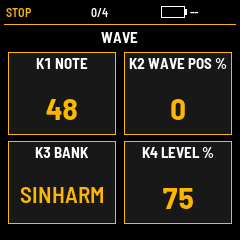
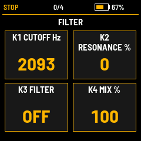
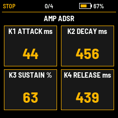
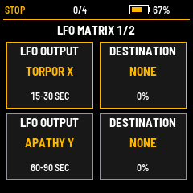
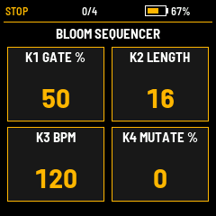
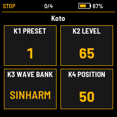
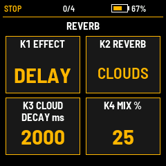

# FM1 wTABLES — Poly Wavetable

Polyphonic wavetable synthesizer firmware for the FM-1. The current published build is **TEST82 / 0.82.0**, featuring an eight-slot shared voice pool, dual-core voice rendering, Bloom sequencing, modulation matrix, and MIDI filter controls.

**Status: experimental test firmware.** The default voice limit remains four. Eight-voice allocator and single/dual-core audio parity checks pass on the host; worst-case eight-voice real-time performance still needs physical FM-1 testing.

## Downloads

- [Built firmware — TEST82 M-Flasher image](firmware/FM1-PolyWavetable-TEST82-8Voice-Dynamic-CC71-74-M-Flasher.bin) (1,048,576 bytes; open the file and choose Download raw file).
- [Browse the complete editable source and build scripts](source/).
- [Download the repository ZIP](https://github.com/Kayman18/FM1-wTABLES/archive/refs/heads/main.zip).
- [Firmware checksums](firmware/SHA256SUMS.txt).

Use the established M-Flasher procedure for this full 1 MiB image. Keep your own device backup before flashing. This image is distinct from the application-only `.fwsc` format; do not rename it to `.fwsc`.

## Actual GUI

These are **240 × 240 framebuffer captures rendered by the matching TEST82 application in its host simulator**, using the firmware drawing code and bundled Barlow fonts. They are not AI mockups or photographs of a physical device. Battery/status readings are simulated.

| Main WAVE page | Filter | Amp envelope |
| --- | --- | --- |
|  |  |  |

| LFO matrix | Bloom sequencer | Preset browser |
| --- | --- | --- |
|  |  |  |



[Capture script](source/tests/readme-screens.txt) · [Capture reproduction instructions](docs/GUI-CAPTURES.md)

## TEST82 changes

- Eight physical voice slots shared across MIDI ports and channels, with coherent unison-group stealing.
- Four even and four odd voice slots balanced across the two rendering cores.
- Shorter 64-sample steal overlap, cached pitch/velocity calculations, and earlier dormant-voice bypass.
- **MIDI CC74:** filter cutoff, 0–127. **MIDI CC71:** resonance, mapped to 0–100%.
- Existing sustain CC64 and pitch bend retained.

The inherited engine includes wavetable banks, per-voice filters and envelopes, LFO/Sloth modulation, Bloom sequencing, chorus, delay, and Clouds/GP5 reverb options. See [TEST82 notes](source/README-TEST82.md) and the source for exact controls.

## Build and validation

The source includes build scripts, matched fonts, and the SDK support subset. The compatible JieLi PI32v2 compiler is a separate dependency.

```sh
cd source
export JIELI_TOOLCHAIN=/absolute/path/to/jieli-toolchain
bash build-TEST82-linux.sh
```

To assemble a full image from a known-compatible 1 MiB backup:

```sh
bash build-TEST82-linux.sh /absolute/path/to/backup.bin output-M-Flasher.bin
```

Run the TEST82 host regression:

```sh
cd source
bash tests/run82.sh
```

The publication check passed under AddressSanitizer/UndefinedBehaviorSanitizer: shared eight-voice allocation, ninth-note stealing, unison-group stealing, 64-sample tails, CC71/CC74 mapping, bounded output, and identical heavy single/dual-core output (`32223d73`). The supplied firmware checksum matches the existing [target validation record](source/TEST82-VALIDATION.md). This publication reuses the delivered target-compiled firmware; it does not claim a new target rebuild or hardware test.

## Source provenance and licenses

TEST82 branches from the complete recovered TEST74-derived staging tree. Exact TEST75–TEST81 application sources were unavailable, so this is not a byte-identical TEST81 successor. Historical notes are retained under `source/`; the current build instructions are `build-TEST82-linux.sh` and `README-TEST82.md`.

Preserved licensing and attribution: [FM1 third-party notices](source/fm1/THIRD_PARTY.md), [base licensing](source/fm1/base/LICENSING.md), and [effect notices](source/THIRD_PARTY/). Consult the relevant files for each component's terms.
